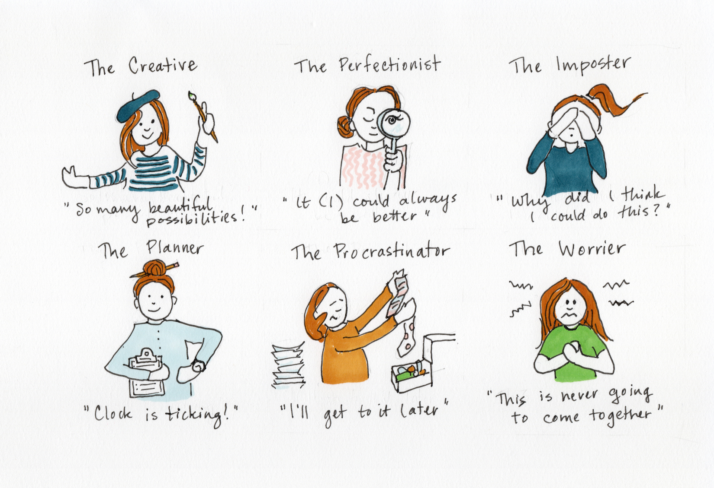
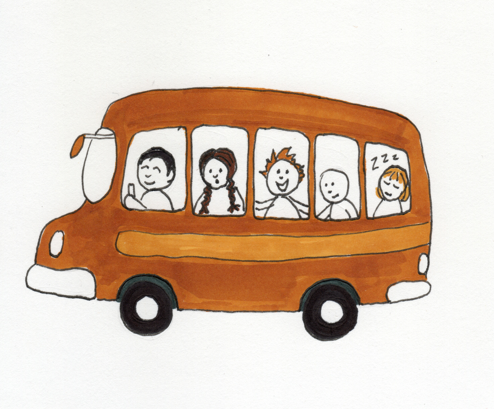

## Our Many Parts

:::{.callout-note icon="false" collapse="false"}
##  Core Competencies Strengthened

_Icon legend: [Values = ]{.cc-value} | [Skills = ]{.cc-skill} | [Stewardship = ]{.cc-steward} | [Results = ]{.cc-result}_

- [ A]{.cc-value}
- [ B]{.cc-skill}
- [ C]{.cc-steward}
- [ D]{.cc-result}

:::

The Whole Brain Model gives us shared language for differences in how people work. But it describes our *preferences*, what we reach for when things are going well. But we aren't always at our best. Sometimes you feel overwhelmed, stuck, or burnt out. When you are feeling that way it may seem like the problem exists outside of you - we take on too much work, other people aren't pulling their weight, etc. - but the source of the overwhelm (and the solution) may actually live inside of you.

Internal Family Systems (IFS) is a model from psychology, developed by Richard Schwartz, that starts from a simple observation: **all of us have multiple sub-parts.** They have different needs, fears, and ways of responding, and they compete for control over how we show up at any given moment. As [Natalie Rofthels](https://www.lennysnewsletter.com/p/why-no-productivity-hack-will-solve) writes, "Some parts help you manage your time, and other parts help you lose track of time entirely; some think analytically, and others work intuitively and non-linearly; some strive for individual excellence, and others prioritize collaboration with your colleagues; some feel competent and confident, and others criticize you and tell you you’re not enough."

When we are feeling stuck, it's often because some voices have gotten really loud or are locked in an internal conflict, pulling you in different directions. The trick is to notice and listen to the competing voices within you.

<figcaption> My multiple parts </figcaption>

A helpful way to picture this is **an internal bus**. You are on the bus, and so are all of your parts. At any given moment, one of them is in the driver's seat, whether or not you are aware of it. The part that jumps in with solutions, the part that gets defensive, and the part that wants everyone to get along may each take a turn at the wheel. Even the same person can show up quite differently depending on what is going on.

<figcaption> Your internal bus </figcaption>

Three additional ideas make this lens especially useful for teams:

- **All of our parts have positive intentions.** Each is trying to help or protect us in some way, and each carries hope and wisdom. The part that gets defensive in a feedback conversation, for instance, may be trying to protect us from feeling like we've failed.
- **We each have a wise inner Self.** This Self can help integrate our many parts and facilitate a dialogue among them to move through inner conflict. Ideally this wise Self is in the driver seat most of the time. When the Self is in the driver seat, people describe a feeling of being "centered."
- **Awareness creates choice.** We cannot always control which part reaches for the wheel, but when we notice who is driving, we have more room to respond thoughtfully instead of simply reacting.

A note on how we use this: we are borrowing IFS as a reflection tool for self-awareness at work. This is not intended as a form of therapy, and nothing here requires you to share more than you want to.

::::{.callout-warning icon="false"}
###  Activity: Who's been driving your bus?"

:::{.panel-tabset}
### **Part 1** - Individual Reflection

On your own reflect silently on these questions:

- Which part of me has been most active this week? Who's been driving my bus recently?
- What is that part trying to do for me? What is it afraid of or hoping for?

### **Part 2** - Pair Discussion

In pairs:

- Share what you noticed either about yourself or about the metaphor of the internal bus. Share only what you are comfortable sharing.
:::
::::

### Tool Highlight: Reflection Prompts for Your Parts

You can use these prompts on your own, in a journal, or in a conversation with a trusted colleague. They work best when you ask them with curiosity rather than judgment.

- *Which part of me has been most active this week? What was going on when it showed up?*
- *What is that part trying to do for me? What is it afraid of or hoping for?*
- *How does it tend to show up in meetings or in conversations with teammates?*
- *What does it need to feel more settled?*
- *What would I want my teammates to know or do to help the part of me that does my best work take the wheel?*
