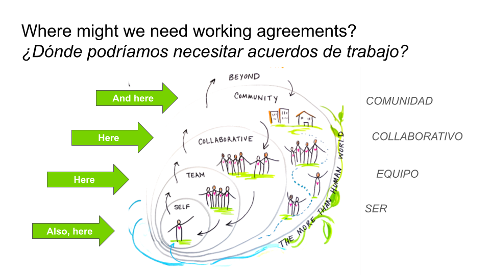

## Working Agreements

:::{.callout-note icon="false" collapse="true"}
##  Section Recording

_Relevant recording to be added; stay tuned!_

:::

One way is through **working agreements**: statements of how we will show up with and for each other.

**Why are they valuable?** Working agreements:

- Allow team members to communicate what is important to them and how they like to work
- Help create the conditions for everyone to show up as the best version of themselves
- Increase mutual accountability, because expectations are visible and shared

### A Note on Terminology

You will hear working agreements called many things. The names overlap, and what matters more than the label is whether the team made them together and they do real work. That said, the terms carry slightly different connotations, so choose the one that best fits your team culture and context.

| **Term** | **Typical feel** | **Where it fits best** |
| -- | ---- | ---- |
| **Working agreements** | Practical and team-made: how we will work together day to day | Ongoing teams and project teams |
| **Ground rules** | Short, often set by a facilitator, for a particular meeting or session | One-off meetings, workshops, and convenings |
| **Norms** | Can describe how a group *actually* behaves as well as how it intends to | Groups reflecting on or reshaping their existing culture |
| **Principles** | Higher level and values-based, less behavioral | Guiding the overall approach of a collaborative, alongside agreements |
| **Code of conduct** | Formal, often organization-wide, tends to imply standards and consequences | Organizations, large communities, and events |
| **Collaboration agreement** | Partnership-flavored, can sound contract-like | Multi-organization collaboratives and client partnerships |

Words like "rules" and "code of conduct" can sound imposed, while "agreement" signals shared ownership. When you work with a client or a larger collaborative, check what language feels comfortable to them. Or ask the group what they want to call it. How people respond is a quick test of whether they feel ownership.

### Where Might We Need Them?

Working agreements are useful anywhere people work together over time, across the nested scales at which we work:

- **Internal teams** - to set expectations for communication, meetings, availability, and decision making
- **Collaboratives and partnerships** - where no one is in charge by default and agreements are part of setting the culture of the collaborative
- **Clients and consulting engagements** - to understand and show up in the way your client expects and enjoys
- **Communities** - to define how members engage with each other

<figcaption> LegacyWorks Group nested scales </figcaption>

You may even want to consider some commitments you want to make to yourself to help your best self  show up in the workplace. Maybe you agree to speak your needs to the group, even when it causes you discomfort, or to get adequate sleep, exercise and nutrition to sustain your energy. What do you need that only you can provide?

### Ingredients of a Good Agreement

Not all agreements are equally useful. "Communicate openly" and "respect each other's time" sound good, but they don't tell anyone what to do. Strong agreements tend to share five ingredients:

| **Ingredient** | **What it means** | 
| --- | ----- |
| **Specific and behavioral** | Says who does what, by when, so you could tell whether it happened | 
| **Tied to a real need** | Exists because it supports how people work best, not because it sounds good | 
| **Plans for exceptions** | Says what happens when it can't be followed or gets broken, and who decides | 
| **Co-created** | Built with everyone who is expected to follow it, not handed down | 
| **Revisited** | Includes a point to check whether it's working and adjust | 

The first three of these ingredients live in the wording of the agreement. The others (co-created, revisited) speak to the process for creating and implementing the agreement. These might not be explicit in the language, but they make the difference between an agreement people follow and a poster on the wall.

#### Weak and Strong Examples

| **Context** | **Weak** | **Strong** | **What the strong version adds** |
| -- | --- | ---- | ---- |
| Communication | "We'll communicate openly." | "If you're blocked or going to miss a deadline, tell the team as soon as you know, not at the next check-in." | Specific and behavioral: you could tell whether it happened |
| Meetings | "We'll respect each other's time." | "Meetings start and end on time. Agendas go out 24 hours ahead, and we release the meeting time if there's nothing for the agenda." | Observable actions with a clear trigger; also serves people who need prep time |
| Responsiveness | "We'll be responsive." | "We respond to messages within one working day. For anything urgent, call or text. Otherwise, we won't expect a same-day reply." | Defines what "responsive" means and separates urgent from non-urgent |
| Decisions | "We'll make decisions together." | "For decisions that affect everyone, we gather input for a week, then the project lead decides and explains the reasoning. For small decisions, whoever owns the task decides." | Clarifies *how* "together" works and who holds authority |

Here is an example that includes all five ingredients:

> "We keep Fridays free of internal meetings so people who need uninterrupted time can do deep work. If something urgent comes up, anyone can ask for an exception, and the team lead decides. If we notice this isn't working, anyone can raise it at our next check-in, and we'll revisit it."

It is specific (no Friday meetings), tied to a need (protected focus time), has a plan for exceptions (how to ask, who decides), and has a review point (the regular check-in). It also only works if the team agreed to it together.

#### Sounds Good, but Is It Tied to a Need?

An agreement can be specific and still fail the test, because it is borrowed from a general idea of what good teams do or from one person's preference, instead of coming from the people in the room.

- **"No emails after 6 pm."** Sounds like good work-life balance, but it solves a problem nobody has if the team spans time zones or some people prefer to clear their inbox in the evening. A need-based version might be: "Nothing sent after 6 pm requires a response before 10 am the next day," which addresses the real concern of not feeling on call.
- **"Everyone keeps their camera on."** Sounds like it builds connection, but it adds friction for someone with a poor connection, a need to move around, or camera fatigue. The underlying need, feeling connected and knowing people are engaged, can be met in other ways.
- **"We'll start every meeting with a check-in round."** Great for relational thinkers, but it may feel like a time-waster to someone who wants to get to the agenda. If no one on the team has expressed a need for it, it is a nice idea and not (yet) an agreement.

The question to ask is: **What need does this serve, and whose need is it?** An agreement that comes from one person's need isn't automatically wrong. "I need agendas ahead of time" can become a team agreement if others see the value or can easily accommodate it. The point isn't that everyone shares the need. It is that the need is visible, so people can make a real choice instead of agreeing to something that sounds good.

Because agreements should be based on the needs of the actual humans trying to work together, they should be built by the team, for the team and revisited whenever team composition shifts. Some moments when it is especially worth having this conversation include:

- At the start of a meeting you are facilitating for a new group or a group that comes together infrequently
- At the beginning of a new year or new project
- When team membership or leadership changes
- When you begin working with a new client or partner

### Starting the Conversation

Working agreements can be built through many kinds of conversations, from a quick check in at the start of a meeting to a more in depth team process. When working with a new client or partner, an initial intake conversation is a great way to elicit material for working agreements. We do this at the start of a relationship, not once friction appears, so that we can show up in the way our partners expect and enjoy. Below are some example questions you can use when establishing a new partnership or client relationship. And here's an [example agenda](https://docs.google.com/document/d/1RIi55gHzqU_8S_u78dYMd-tC7DonDJHXeLAwisb-CPc/copy) for an initial client launch meeting with some of these questions embedded – feel free to reuse and adapt!

#### Sample Questions

**Communication**

- How do you prefer to communicate and what are your urgency levels for each channel, e.g. Slack DMs for general updates, texts for emergencies. 
- If someone on the team needs an immediate response, what’s the best way (email, text, phone call)?

**Availability & Scheduling**

- When will you be available for the team? What are your standard working hours? 
- Do you have preferred times for one type of work over another, e.g. you want to write in the mornings and have meetings in the afternoons?
- How much advance time do you need for scheduling calls or virtual meetings?

**Approach to Collaboration**

- How do you prefer to collaborate? Do you like to confer then divide up tasks and work side by side? Be given specific tasks to complete and then report back? Work on the same task simultaneously (e.g. in a shared doc)?
- What are your superpowers (strengths)? What are you great at and love? 
- What’s your kryptonite (weaknesses)? What stresses you out, and how can we navigate that stress? 
- What do you want help with or want to delegate?
- A meeting / collaboration pet peeve is…
- What suggestions do you have for making the best of our collaboration?

**Reflection & Review**

- I think best by… (e.g. writing, having time to reflect, talking, drawing, moving…)
- How much advance time do you need for reviewing things?
- Do you prefer to iterate early drafts or see polished products?

**Platforms and tools**

- What platforms and software tools do you use for sharing documents, communication, virtual meetings? 
- Are there any you cannot use due to institutional restrictions?

#### Matching Depth to Context

You don't need to use every lens every time. Match the depth of the conversation to the relationship and the level of trust:

| **Situation** | **Approach** |
| -- | ---- |
| A new client or short-term collaboration | A light work style questionnaire: quick, practical, and low-vulnerability |
| An ongoing team with some trust | Thinking preferences, plus the "you at your best" reflection, to understand each other's defaults and what matters |
| A team with real trust, or one working through friction | Add the parts reflection, which asks for more openness |

#### What Agreements Can Be About

If you're not sure where to start, here is a menu of topics that agreements commonly cover:

- Equitable participation and inclusivity
- Communication norms (e.g., openness, honesty, vulnerability)
- Giving and receiving feedback
- Communication channels and response times
- Meetings (purpose, length, agendas, who attends)
- Availability and working hours
- Review and feedback (how much time, in what form)
- Decision making authority and model (scope and who and how we make decisions)
- How we handle disagreements, mistakes, and slipped agreements

### Tool Highlight: Min Specs

[Min Specs](https://www.liberatingstructures.com/14-min-specs/) is a Liberating Structure well suited to developing working agreements, especially with experimental thinkers who may be wary of lots of rules. Individuals brainstorm the things the group *must* do or *must not* do to achieve its purpose, share in pairs or small groups, and then pare the list down to the minimum set of rules the group could follow and still achieve its purpose. It pairs naturally with [1-2-4-All](https://www.liberatingstructures.com/1-1-2-4-all/) for engaging everyone. For more on these and other microstructures, see the [Effective Meetings module](https://legacyworksgroup.github.io/inclusive-facilitation/content/meetings.html#tool-highlights-microstructures).

### Practice: Co-developing Working Agreements

You've seen the ingredients and a real-world example. Now it is time to try it. Your drafts don't need to be perfect. We are practicing the process.

::::{.callout-warning icon="false"}
###  Activity: Drafting Working Agreements

:::{.panel-tabset}
### Part 1 - Small Group Discussion

**The scenario**

You've just joined a new collaborative made up of representatives from several organizations working toward a shared community goal. No single organization is in charge, and the group will work together for the next year, meeting virtually once a month. Members have very different amounts of time to give, and some can make decisions on the spot while others need to check with a board or supervisor first. At your first meeting, the group decides to draft working agreements before getting into the work.

**In small groups of 3-4** (18 minutes)

You'll play yourself, bringing your own working style and the needs and offers you jotted down in the journaling activity. Choose one person to record in the shared notes document.

1. **Share (4 min).** Going around the group, each person shares one need and one offer. The person whose first name comes first alphabetically starts.
2. **Notice (3 min).** Where do your needs overlap? Where do they differ?
3. **Draft (8 min).** Turn two or three of your needs into agreements for this collaborative. Two or three is plenty. Aim for agreements that someone could actually observe.
4. **Check (3 min).** Test each draft against the five ingredients. Revise anything that falls short.

**You're done when** you have two or three draft agreements and have checked each against the ingredients. They don't need to be perfect. We are practicing the process.

When we return, be ready to share one agreement and why you wrote it that way.

### Part 2 - Whole-Class Discussion

As a whole class, let's discuss:

- Which ingredients were easy to meet? Which were hard?
- Whose needs showed up in your draft? Whose might have been left out?
- What did you notice about the process, as someone who may run it?
- What would you do differently with a real team?

:::
::::
